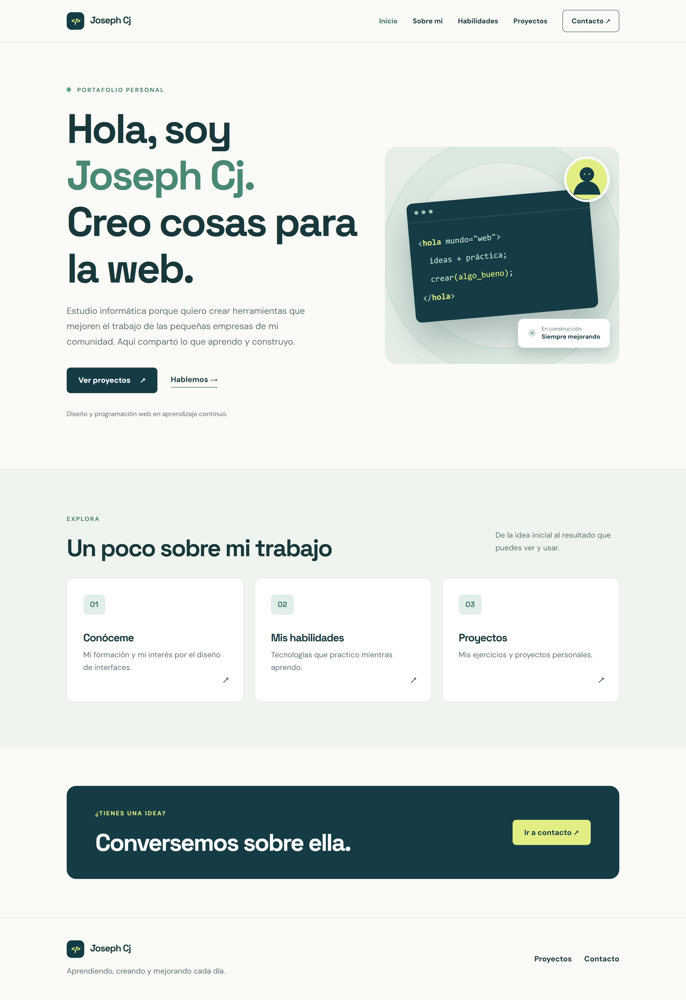
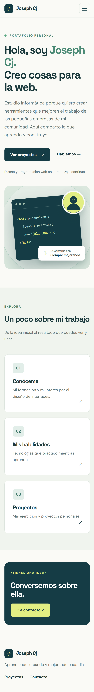

# Portafolio de Joseph Cj · Introducción a la Programación Web

Proyecto Django sin base de datos, modelos, autenticación ni panel de administración. El contenido se escribe en las plantillas HTML, sin ciclos `for`.

## Ejecutar

Se requiere Python 3.10 o posterior. Desde esta carpeta:

```bash
python -m venv .venv
```

Activar el entorno en macOS/Linux: `source .venv/bin/activate`; en Windows PowerShell: `.venv\Scripts\Activate.ps1`. Luego:

```bash
python -m pip install -r requirements.txt
python manage.py check
python manage.py runserver
```

Abrir `http://127.0.0.1:8000/`. Para comprobar la página 404, abrir una dirección inexistente, por ejemplo `/no-existe/`. No se necesita `migrate` porque no hay modelos ni base de datos.

## Rutas

| Página | Ruta | Plantilla |
| --- | --- | --- |
| Inicio | `/` | `inicio.html` |
| Sobre mí | `/sobre-mi/` | `sobre_mi.html` |
| Habilidades | `/habilidades/` | `habilidades.html` |
| Proyectos | `/proyectos/` | `proyectos.html` |
| Contacto | `/contacto/` | `contacto.html` |
| Error 404 | cualquier ruta inexistente | `404.html` |

`base.html` comparte navegación y pie; cada vista envía `titulo` a su plantilla. Los archivos estáticos están bajo `portafolio/static/portafolio/`.

## Funciones de JavaScript

1. Menú móvil accesible: abre/cierra con botón; cierra al pulsar Escape, un enlace o al pasar a escritorio.
2. Filtro por tecnología sin recarga y con anuncio del número de resultados.
3. Validación de nombre, correo y mensaje; confirma en pantalla, limpia el formulario válido y **no envía datos**.

## Antes de entregar

- Revisar la biografía y los niveles de habilidades para que coincidan con tu experiencia real.
- Completar la descripción real de la tienda y reemplazar las ilustraciones por capturas originales de los tres proyectos en `static/portafolio/img/`, usando `` y `alt` descriptivo.
- Agregar enlaces reales para la tienda y el portafolio; comprobar el enlace a Tic-tac-toe y el perfil de GitHub. El formulario solo demuestra validación; no promete contacto efectivo.
- Agregar foto o avatar autorizado, actualizar niveles de habilidades y completar `docs/inventario.md`.
- Diseñar en Figma según `docs/figma.md` y comparar capturas de 1440 px y 390 px con el sitio. La fuente Google Fonts necesita internet; si no carga, se usa sans-serif.
- Crear un repositorio en tu cuenta de GitHub y registrar commits durante tu propio trabajo; no atribuirte commits generados retrospectivamente. Añadir al README final el enlace al archivo de Figma, el prototipo y las capturas comparativas.

## Archivos de planificación

- `docs/mapa-del-sitio.md`: diagrama, rutas y navegación.
- `docs/inventario.md`: textos actuales, recursos y datos pendientes.
- `docs/figma.md`: especificaciones para wireframes, componentes, mockups y prototipo.

> La configuración `DEBUG=True` y la clave incluida son solo para ejecutar localmente. Configurar Django adecuadamente antes de cualquier publicación.

## Diseño en Figma

- Archivo de diseño: https://www.figma.com/design/fXwbT6LnpYrHISrMn8OQIC/Sin-t%C3%ADtulo
- Prototipo: https://www.figma.com/proto/fXwbT6LnpYrHISrMn8OQIC/Sin-t%C3%ADtulo?node-id=10-29&page-id=10%3A28&starting-point-node-id=10%3A29&scaling=min-zoom&content-scaling=fixed

## Capturas del sitio

### Inicio en escritorio


### Inicio en móvil

