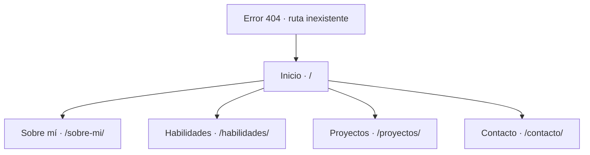

# Fase 1 · Mapa del sitio

La navegación principal conecta todas las páginas. El pie enlaza a Inicio, Proyectos y Contacto; la portada ofrece accesos directos a Sobre mí, Habilidades, Proyectos y Contacto. Una URL desconocida lleva al error 404 y desde allí se regresa al inicio.

## Enlaces adicionales

| Origen | Destino | Cómo se accede |
| --- | --- | --- |
| Cualquier página | Inicio, Sobre mí, Habilidades, Proyectos, Contacto | Barra principal; menú desplegable en móvil |
| Inicio | Proyectos y Contacto | Botones destacados |
| Inicio | Sobre mí, Habilidades, Proyectos | Tarjetas de exploración |
| Sobre mí | Contacto | Enlace al final de la biografía |
| Habilidades | Proyectos | Botón en la sección final |
| Cualquier página | Inicio, Proyectos y Contacto | Pie de página |
| Error 404 | Inicio | Botón de regreso |

Exporta el diagrama como imagen o recréalo en FigJam, Figma o draw.io para la entrega de la fase 1.
